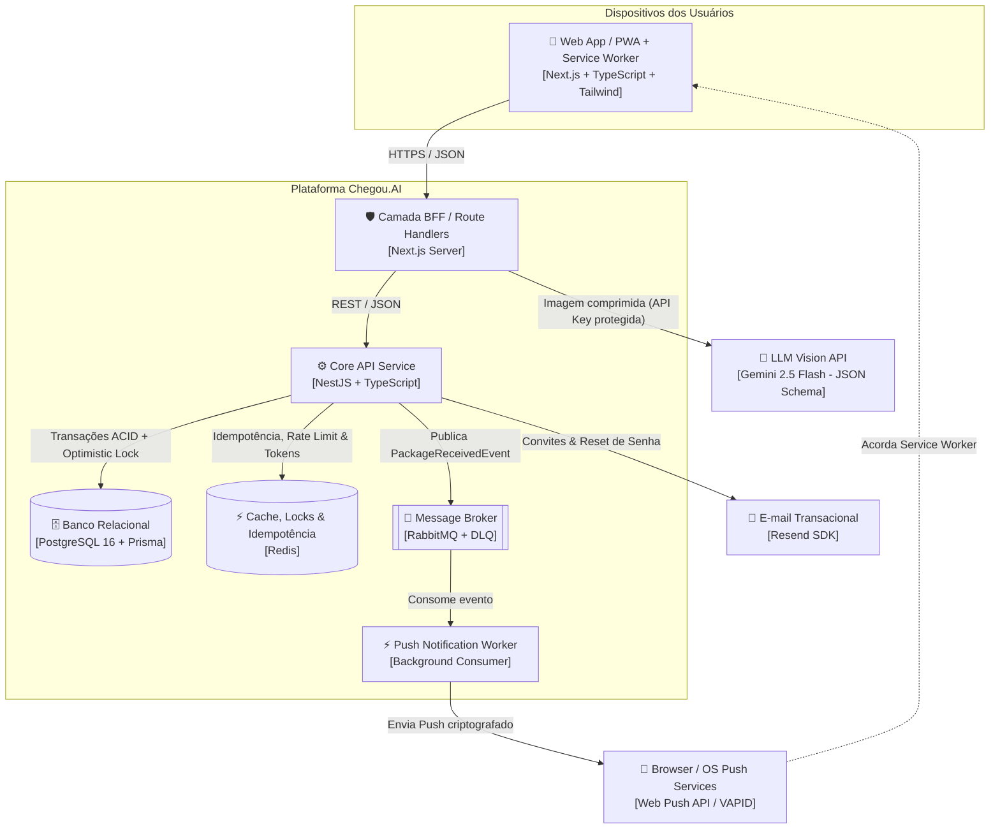

# Chegou.AI - Gestão Inteligente de Encomendas com Visão Computacional & Web Push

> **Check-in de encomendas em menos de 10 segundos na portaria** usando extração *zero-shot* de etiquetas por IA (Gemini 2.5 Flash), alertas assíncronos via **Web Push Notifications** (VAPID) e baixa auditável com **QR Code / PIN único de 6 dígitos**.

---

## 🎯 O Problema de Negócio

Portarias de condomínios residenciais e comerciais sofrem com filas em horários de pico, etiquetas rasgadas/ilegíveis, atrasos na comunicação com moradores e risco de entrega incorreta por falta de rastreabilidade.

O **Chegou.AI** resolve esse gargalo substituindo cadernos e digitação manual por um fluxo digital orientado a eventos:
1. **Smart Check-in (IA):** O porteiro fotografa a etiqueta; a IA extrai destinatário, bloco/apartamento, transportadora e código de rastreio em formato estruturado (`JSON Schema`), validando se o endereço na etiqueta confere com os endereços oficiais do condomínio.
2. **Notificação Assíncrona em Tempo Real:** O registro publica um evento em fila (`RabbitMQ`), disparando **Web Push Notifications** diretamente para os dispositivos inscritos do morador (custo zero de mensageria).
3. **Cadeia de Custódia Auditável:** A retirada só é concluída mediante validação atômica e idempotente de um **PIN de 6 dígitos** ou **QR Code**, gerando trilha de auditoria imutável (`append-only`).

---

## 🏗️ Arquitetura de Alto Nível (C4 - Contêineres)



---

## 📚 Documentação Interativa da API (Swagger / OpenAPI)

A API do Chegou.AI possui documentação interativa gerada automaticamente através do **Swagger UI / OpenAPI**:

- **Swagger UI Interativo:** `http://localhost:8080/api/docs`
- **Especificação OpenAPI (JSON):** `http://localhost:8080/api/docs-json`
- **Importação no Postman / Insomnia:** Basta importar a URL `http://localhost:8080/api/docs-json` para carregar toda a coleção com 1 clique.

> **Dica de Autenticação no Swagger:** Clique no botão verde **Authorize** no topo do Swagger UI e insira o token obtido no login no formato `Bearer <seu-token-jwt>`.

---

## 📡 Catálogo Completo de Rotas da API (33 Endpoints)

### 1. Autenticação & Primeiro Acesso (`Auth`)

| Método | Rota | Permissão | Descrição & Regras de Negócio | Rate Limit |
|---|---|:---:|---|:---:|
| `POST` | `/api/v1/auth/login` | Pública | Autenticação com e-mail e senha. Retorna dados do usuário e token JWT. | 5/min |
| `POST` | `/api/v1/auth/demo/:role` | Pública (Dev) | Login rápido de demonstração (`admin`, `porteiro`, `morador`). Desativado em produção. | 15/min |
| `POST` | `/api/v1/auth/logout` | Pública | Encerramento de sessão e instrução de limpeza de cookies/tokens. | - |
| `GET` | `/api/v1/auth/me` | Autenticado | Retorna o perfil, permissão e unidade vinculada do usuário logado. | - |
| `POST` | `/api/v1/auth/setup-initial-admin` | Pública* | Auto-provisionamento do primeiro síndico e condomínio quando o banco está zerado (*bloqueia após 1º admin). | 5/min |
| `POST` | `/api/v1/auth/activate` | Pública | Valida token de convite no Redis e cadastra a nova senha do morador (anti-replay). | 10/min |
| `POST` | `/api/v1/auth/forgot-password` | Pública | Solicitação de recuperação de senha. Gera token no Redis e envia e-mail com link seguro. | 5/min |
| `POST` | `/api/v1/auth/reset-password` | Pública | Valida token de redefinição no Redis e atualiza a senha criptografada com bcrypt. | 5/min |

### 2. Condomínio & Endereços Oficiais (`Condominium`)

| Método | Rota | Permissão | Descrição & Regras de Negócio |
|---|---|:---:|---|
| `GET` | `/api/v1/condominium/profile` | `ADMIN`, `PORTER`, `RESIDENT` | Retorna os dados cadastrais e perfil institucional do condomínio. |
| `PUT` | `/api/v1/condominium/profile` | `ADMIN` | Atualiza o nome, CNPJ e regras gerais do condomínio. |
| `GET` | `/api/v1/condominium/addresses` | `ADMIN`, `PORTER`, `RESIDENT` | Lista os endereços oficiais e apelidos cadastrados para validação pela IA. |
| `POST` | `/api/v1/condominium/addresses` | `ADMIN` | Cadastra nova portaria ou entrada com lista de aliases para OCR. |
| `PATCH` | `/api/v1/condominium/addresses/:id` | `ADMIN` | Atualiza logradouro, número, CEP ou aliases do endereço oficial. |
| `DELETE` | `/api/v1/condominium/addresses/:id` | `ADMIN` | Remove endereço secundário (o condomínio deve manter no mínimo 1 endereço ativo). |

### 3. Gestão de Operadores e Usuários (`Users`)

| Método | Rota | Permissão | Descrição & Regras de Negócio |
|---|---|:---:|---|
| `GET` | `/api/v1/users` | `ADMIN` | Lista operadores da portaria e administradores com paginação e busca por nome/email. |
| `GET` | `/api/v1/users/:id` | `ADMIN` | Detalhes do usuário operador por UUID. |
| `POST` | `/api/v1/users` | `ADMIN` | Cadastra novo porteiro ou síndico com validação de unicidade de e-mail e hash bcrypt. |
| `PUT` | `/api/v1/users/:id` | `ADMIN` | Edita dados cadastrais ou redefine senha de acesso do operador. |
| `PATCH` | `/api/v1/users/:id/toggle-status` | `ADMIN` | Alterna status ativo/inativo, revogando logins futuros sem perder histórico de auditoria. |
| `DELETE` | `/api/v1/users/:id` | `ADMIN` | Remove o operador; se possuir encomendas vinculadas, desativa a conta (deleção lógica). |

### 4. Unidades e Blocos (`Units`)

| Método | Rota | Permissão | Descrição & Regras de Negócio |
|---|---|:---:|---|
| `GET` | `/api/v1/units` | Pública / Autenticado | Lista unidades do condomínio. Dados de moradores são omitidos para anônimos (LGPD). |
| `GET` | `/api/v1/units/template-csv` | `ADMIN` | Retorna modelo CSV padrão para importação de blocos e apartamentos. |
| `POST` | `/api/v1/units/import-batch` | `ADMIN` | Importação em lote de unidades via planilha CSV ignorando duplicidades. |
| `GET` | `/api/v1/units/:id` | `ADMIN`, `PORTER`, `RESIDENT`* | Consulta unidade e moradores (*morador só acessa se pertencer ao próprio apartamento). |
| `POST` | `/api/v1/units` | `ADMIN` | Cadastra individualmente uma unidade (Bloco e Número). |
| `PUT` | `/api/v1/units/:id` | `ADMIN` | Atualiza informações da unidade e status ativo. |
| `DELETE` | `/api/v1/units/:id` | `ADMIN` | Remove unidade se não houver moradores ou encomendas vinculadas. |

### 5. Moradores & Notificações Push (`Residents`)

| Método | Rota | Permissão | Descrição & Regras de Negócio |
|---|---|:---:|---|
| `GET` | `/api/v1/residents` | `ADMIN`, `PORTER` | Lista condôminos com filtro opcional por `unitId` (protegido por LGPD). |
| `GET` | `/api/v1/residents/me/packages` | `RESIDENT`, `ADMIN` | Lista encomendas pendentes e histórico do morador logado com PIN de 6 dígitos e QR Code. |
| `POST` | `/api/v1/residents/me/push-subscriptions` | `RESIDENT` | Registra endpoint e chaves VAPID (`p256dh`, `auth`) do navegador para Web Push. |
| `GET` | `/api/v1/residents/template-csv` | `ADMIN` | Retorna modelo CSV para importação de moradores com telefone e contato principal. |
| `POST` | `/api/v1/residents/import-batch` | `ADMIN` | Carga em lote de moradores via CSV vinculando automaticamente às unidades. |
| `GET` | `/api/v1/residents/:id` | `ADMIN`, `PORTER` | Consulta cadastro completo do morador por UUID. |
| `POST` | `/api/v1/residents` | `ADMIN` | Cadastra morador com conta inicial inativa e despacha convite automático por e-mail. |
| `PUT` | `/api/v1/residents/:id` | `ADMIN` | Edita dados cadastrais do condômino (nome, telefone, apartamento). |
| `DELETE` | `/api/v1/residents/:id` | `ADMIN` | Exclui cadastro do morador e remove conta de acesso associada. |
| `POST` | `/api/v1/residents/:id/invite` | `ADMIN` | Gera novo token criptográfico de 256 bits no Redis (7 dias) e dispara e-mail de convite. |

### 6. Encomendas & Cadeia de Custódia (`Packages`)

| Método | Rota | Permissão | Descrição & Regras de Negócio |
|---|---|:---:|---|
| `POST` | `/api/v1/packages` | `PORTER`, `ADMIN` | Check-in de encomenda na portaria. Suporta header `idempotency-key` e gera PIN de retirada. |
| `POST` | `/api/v1/packages/checkout` | `PORTER`, `ADMIN` | Baixa atômica de encomenda via PIN ou QR Code com comparação segura bcrypt e optimistic locking. |
| `GET` | `/api/v1/packages` | `PORTER`, `ADMIN`, `RESIDENT` | Listagem de encomendas. Moradores são filtrados estritamente à sua unidade (Anti-BOLA/IDOR). |
| `GET` | `/api/v1/packages/:id` | `PORTER`, `ADMIN`, `RESIDENT` | Detalhes da encomenda (moradores só conseguem visualizar encomendas da sua unidade). |
| `PATCH` | `/api/v1/packages/:id/cancel` | `PORTER`, `ADMIN` | Devolução à transportadora ou cancelamento. Invalida tokens e registra na auditoria. |

### 7. BFF & Visão Computacional (`BFF / AI`)

| Método | Rota | Permissão | Descrição & Regras de Negócio |
|---|---|:---:|---|
| `POST` | `/api/v1/bff/packages/extract-label` | `PORTER`, `ADMIN` | Envia imagem da etiqueta para OCR via Gemini 2.5 Flash, valida se o endereço confere com o condomínio e faz match de apartamento. |

### 8. Trilha de Auditoria & Relatórios (`Audit`)

| Método | Rota | Permissão | Descrição & Regras de Negócio |
|---|---|:---:|---|
| `GET` | `/api/v1/audit/events` | `ADMIN` | Lista eventos imutáveis de custódia (`CREATED`, `NOTIFIED`, `DELIVERED`, `CANCELLED`). |
| `GET` | `/api/v1/audit/metrics` | `ADMIN` | Retorna métricas de custódia (encomendas recebidas hoje, entregues hoje e pendentes). |
| `GET` | `/api/v1/audit/export` | `ADMIN` | Exporta relatório completo em formato CSV com higienização contra CSV Injection. |

---

## 🛠️ Tecnologias Utilizadas

- **Front-end / BFF (`apps/web`):** Next.js (App Router), TypeScript, Tailwind CSS, shadcn/ui, Magic UI, Lucide React, Service Worker (PWA + Web Push).
- **Back-end Core (`apps/api`):** NestJS, TypeScript, Prisma ORM, Swagger/OpenAPI, Passport JWT, Throttler, Helmet.
- **Banco de Dados & Cache:** PostgreSQL 16 (transações ACID e integridade referencial), Redis (idempotência, rate limiting, locks e tokens temporários).
- **Mensageria:** RabbitMQ com Dead Letter Queue (DLQ).
- **Inteligência Artificial:** Google Gemini 2.5 Flash com JSON Schema estrito e validação cruzada de endereços.
- **E-mails Transacionais:** Resend SDK com templates HTML corporativos e fallback automático.

---

## 🚀 Como Executar o Projeto Localmente

### 1. Clonar e Instalar Dependências
```bash
# Na raiz do projeto:
npm install
npm --prefix apps/api install
npm --prefix apps/web install
```

### 2. Configurar Variáveis de Ambiente
Copie os arquivos de exemplo:
```bash
cp .env.example .env
cp apps/api/.env.example apps/api/.env
```

### 3. Subir Banco de Dados e Redis
```bash
docker compose up -d
```

### 4. Executar Migrações do Prisma
```bash
npm --prefix apps/api run prisma:generate
npm --prefix apps/api run prisma:migrate
```

### 5. Iniciar os Serviços
```bash
# Backend NestJS (porta 8080):
npm --prefix apps/api run start:dev

# Frontend Next.js (porta 3000):
npm --prefix apps/web run dev
```

Acesse a aplicação em `http://localhost:3000` e a documentação Swagger em `http://localhost:8080/api/docs`.
