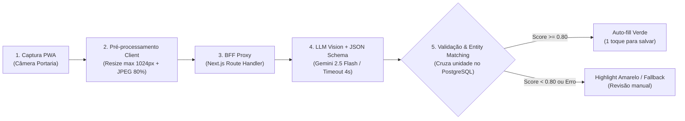

# Engenharia de IA, Pipeline de Extração & Evals (`Chegou.AI`)

Este documento especifica o pipeline de Visão Computacional responsável pela leitura *zero-shot* de etiquetas de encomendas, incluindo estratégias de redução de latência, *Structured Outputs*, prevenção de alucinações e métricas de avaliação contínua (*Evals*).

---

## 1. Arquitetura do Pipeline de Extração

Para atingir a meta de latência **P95 menor que 2,5 segundos** e minimizar custos de tokens de visão, o processamento segue 5 etapas sequenciais:



### Detalhamento das Etapas

* **Pré-processamento no Navegador (Client-side):** Antes do upload, o PWA redimensiona a foto via HTML5 `<canvas>` para no máximo 1024px no maior lado e comprime em JPEG (`quality: 0.80`). Isso reduz o payload de ~4 MB para ~180 KB, economizando banda no Wi-Fi da portaria e reduzindo o tempo de upload e ingestão de tokens.
* **Camada BFF (Segurança & Rate Limit):** O Next.js valida a sessão do porteiro, aplica rate limiting (máx. 30 scans/min por terminal) e envia a imagem em memória para a API do provedor de IA, sem persistir fotos brutas em disco (conformidade LGPD).
* **Inferência com Structured Outputs:** O modelo é forçado a responder estritamente conforme o JSON Schema definido (sem texto conversacional ou markdown).
* **Fuzzy Entity Matching (Pós-processamento):** O sistema normaliza o bloco/apartamento extraído (ex.: "Bloco B, Ap 402" $\rightarrow$ `block="B"`, `number="402"`) e consulta o banco de moradores para validar se o `recipientName` coincide com algum residente cadastrado naquela unidade, elevando a confiabilidade da sugestão.

---

## 2. System Prompt & JSON Schema Estrito

### System Prompt

```plaintext
Você é um especialista em logística condominial e extração de dados de etiquetas de transporte.
Analise a imagem da etiqueta de encomenda fornecida e extraia exclusivamente os dados do DESTINATÁRIO final (morador), ignorando os dados do remetente/loja.

Regras estritas:
1. Nunca invente ou suponha dados ilegíveis. Se um campo estiver rasgado, borrado ou ausente, retorne null.
2. Diferencie o endereço fixo do condomínio (rua, número predial, CEP) da identificação interna da unidade (Bloco, Torre, Quadra, Apartamento, Sala, Casa).
3. Normalize o nome da transportadora quando identificável pelo logotipo ou padrão de código (ex: Mercado Livre, Amazon, Shopee, Correios, Jadlog, Loggi).
4. Calcule o `confidenceScore` (0.0 a 1.0) refletindo a legibilidade real da etiqueta e a certeza sobre a unidade e o nome do destinatário.
```

### Response JSON Schema (Strict Mode)

```json
{
  "type": "object",
  "properties": {
    "recipientName": {
      "type": ["string", "null"],
      "description": "Nome completo ou parcial do destinatário impresso na etiqueta."
    },
    "unitBlock": {
      "type": ["string", "null"],
      "description": "Identificador do bloco ou torre (ex: 'A', '1', 'Torre Norte'). Null se bloco único ou ausente."
    },
    "unitNumber": {
      "type": ["string", "null"],
      "description": "Número do apartamento, sala ou casa do destinatário (ex: '402', '101B')."
    },
    "trackingCode": {
      "type": ["string", "null"],
      "description": "Código de rastreamento alfanumérico principal."
    },
    "carrier": {
      "type": ["string", "null"],
      "description": "Nome da transportadora ou marketplace (ex: Mercado Livre, Amazon, Shopee, Correios)."
    },
    "confidenceScore": {
      "type": "number",
      "minimum": 0,
      "maximum": 1,
      "description": "Nível de confiança global da extração (0.00 a 1.00)."
    },
    "uncertaintyReason": {
      "type": ["string", "null"],
      "description": "Motivo curto caso confidenceScore seja menor que 0.80 (ex: 'Etiqueta rasgada na região do apartamento')."
    }
  },
  "required": [
    "recipientName",
    "unitBlock",
    "unitNumber",
    "trackingCode",
    "carrier",
    "confidenceScore",
    "uncertaintyReason"
  ],
  "additionalProperties": false
}
```

---

## 3. Guardrails & Prevenção de Falhas

| Risco | Mitigação Arquitetural |
| :--- | :--- |
| **Alucinação de Unidade** | Temperatura configurada em 0.0 (determinística). Se `unitNumber` não existir na tabela `units` do condomínio, o back-end invalida o match automático e força seleção via dropdown pelo porteiro. |
| **Latência / Indisponibilidade da API de IA** | Timeout HTTP rígido de 4.000 ms no BFF. Ao estourar o timeout ou receber HTTP 429/5xx, o front-end abre imediatamente o formulário manual sem bloquear o fluxo da portaria. |
| **Prompt Injection via Etiqueta** | O modelo recebe instruções de sistema isoladas e saída restrita a tipos primitivos validados por schema (Zod/JSON Schema). |
| **Vazamento de Dados Pessoais (PII)** | Imagens trafegam apenas em memória (Buffer), nunca são salvas em S3/disco, e o provedor de IA é configurado com retenção zero de dados (Zero Data Retention). |

---

## 4. Estratégia de Avaliação (Evals) & Observabilidade

Para garantir que atualizações de prompt ou troca de modelo não degradem a qualidade, o projeto mantém um **Golden Dataset** (conjunto de validação) e telemetria implícita em produção:

### Offline Evals (CI/CD antes de deploy de prompt)
* Conjunto de 50 imagens sintéticas/anonimizadas cobrindo etiquetas térmicas padrão, etiquetas amassadas, baixa iluminação, etiquetas sem número de bloco e etiquetas com dois nomes.
* **Métricas avaliadas:**
  * **Exact Match Rate (Unidade):** Meta $\ge$ 92% nas etiquetas legíveis.
  * **False Confidence Rate:** % de vezes em que o modelo retornou `confidenceScore >= 0.80`, mas errou o apartamento (Meta < 2%).

### Online Implicit Eval (Feedback Loop em Produção)
* Toda vez que o porteiro edita um campo sugerido pela IA antes de clicar em "Salvar", o sistema registra o evento `AI_EXTRACTION_CORRECTED` (sem armazenar a imagem, apenas quais campos foram alterados), permitindo monitorar a taxa real de acerto sem edição manual (KPI de produto: > 85%).
