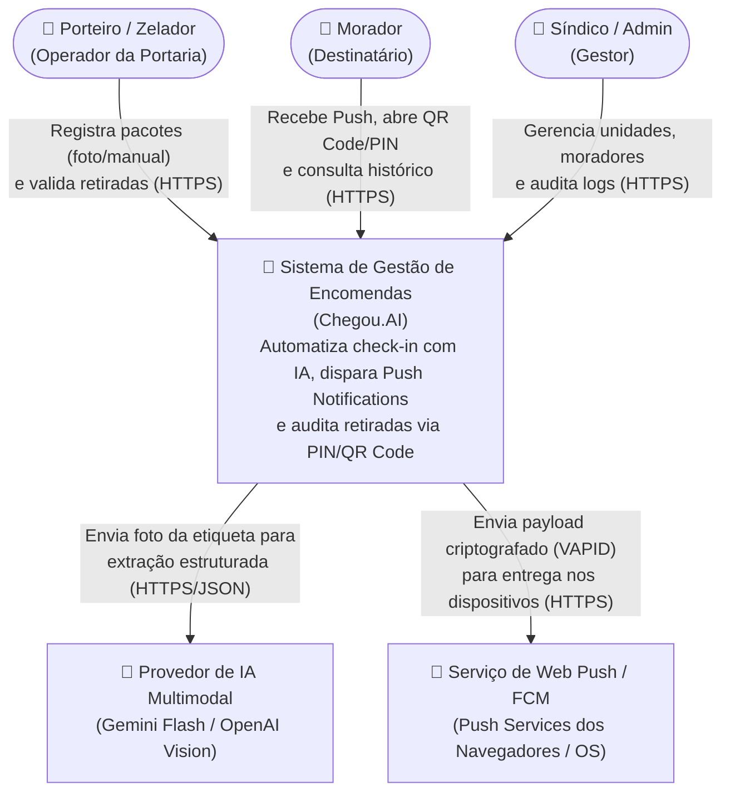
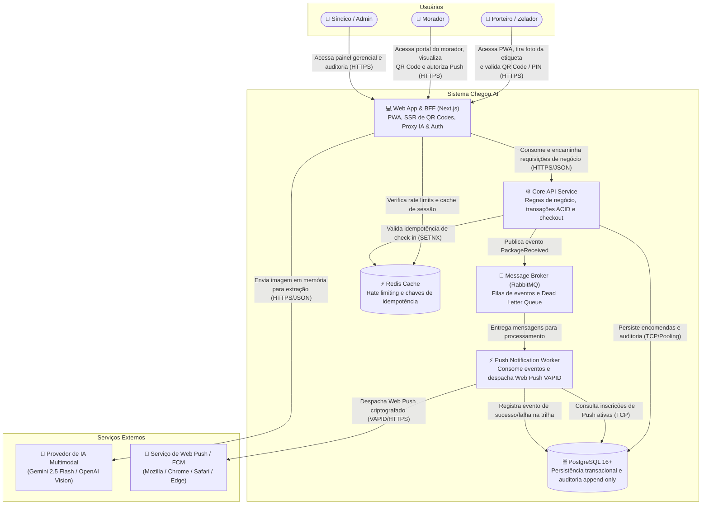
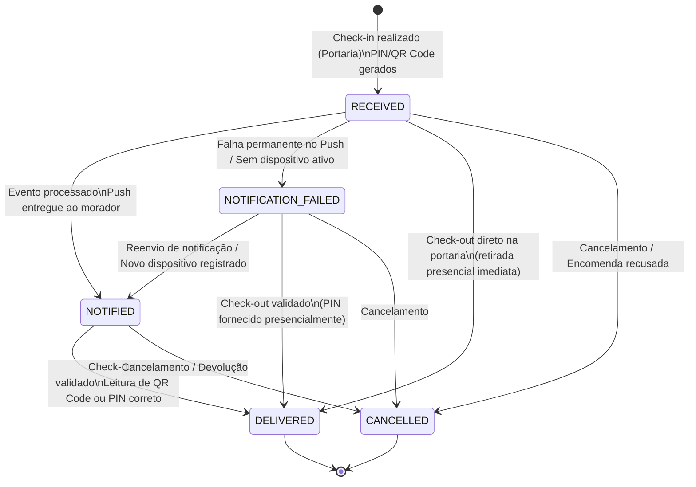

# Arquitetura de Sistemas & Diagramas C4 (`Chegou.AI`)

Este documento apresenta a arquitetura do **Chegou.AI** utilizando o **Modelo C4** (Contexto e Contêineres) e a **Máquina de Estados** que governa o ciclo de vida de cada encomenda.

---

## 1. Modelo C4 — Nível 1: Diagrama de Contexto

Mostra como o sistema se posiciona no ambiente condominial e suas dependências externas.

---

## 2. Modelo C4 — Nível 2: Diagrama de Contêineres

Descreve a fronteira interna dos contêineres e serviços que compõem o **Chegou.AI**, detalhando as responsabilidades do BFF, do Core API, da fila assíncrona e dos workers.

---

## 3. Máquina de Estados: Ciclo de Vida da Encomenda

Define os estados válidos e as transições possíveis de uma encomenda desde o check-in na portaria até a retirada ou eventual cancelamento.

