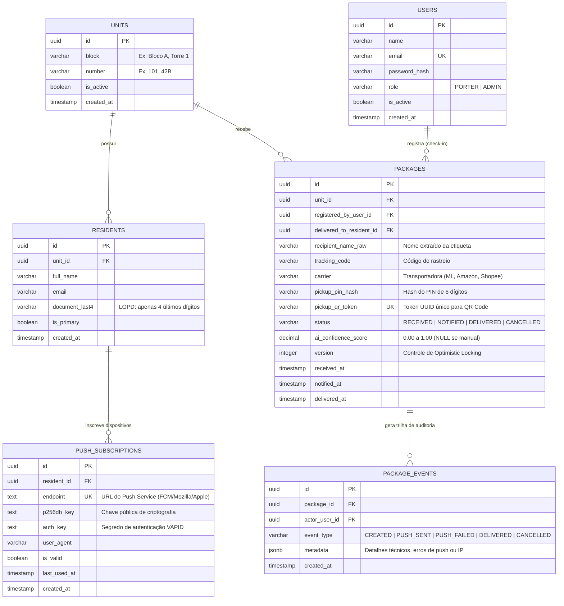

# Modelagem de Dados & Schema SQL (`Chegou.AI`)

Este documento descreve o Modelo Entidade-Relacionamento (DER) e o DDL do **PostgreSQL 16+**, projetado para garantir consistência ACID, auditoria imutável e suporte a Web Push Notifications.

---

## 1. Diagrama Entidade-Relacionamento (DER)



---

## 2. Schema SQL (PostgreSQL DDL)

```sql
-- Extensão para geração de UUIDs v4
CREATE EXTENSION IF NOT EXISTS "pgcrypto";

-- Enum para perfis operacionais
CREATE TYPE user_role AS ENUM ('PORTER', 'ADMIN');

-- Enum para ciclo de vida da encomenda
CREATE TYPE package_status AS ENUM (
    'RECEIVED',
    'NOTIFIED',
    'NOTIFICATION_FAILED',
    'DELIVERED',
    'CANCELLED'
);

-- 1. Unidades do Condomínio
CREATE TABLE units (
    id UUID PRIMARY KEY DEFAULT gen_random_uuid(),
    block VARCHAR(20) NOT NULL DEFAULT 'UNICO',
    number VARCHAR(20) NOT NULL,
    is_active BOOLEAN NOT NULL DEFAULT TRUE,
    created_at TIMESTAMPTZ NOT NULL DEFAULT NOW(),
    CONSTRAINT uq_unit_block_number UNIQUE (block, number)
);

-- 2. Moradores vinculados às unidades
CREATE TABLE residents (
    id UUID PRIMARY KEY DEFAULT gen_random_uuid(),
    unit_id UUID NOT NULL REFERENCES units(id) ON DELETE RESTRICT,
    full_name VARCHAR(150) NOT NULL,
    email VARCHAR(150) NOT NULL,
    phone VARCHAR(20), -- Celular/WhatsApp (ADR-006, ex: '(11) 98765-4321' ou E.164)
    document_last4 CHAR(4),
    is_primary BOOLEAN NOT NULL DEFAULT FALSE,
    created_at TIMESTAMPTZ NOT NULL DEFAULT NOW()
);

CREATE INDEX idx_residents_unit_id ON residents(unit_id);
CREATE INDEX idx_residents_email ON residents(email);

-- 3. Inscrições Web Push (VAPID) por dispositivo do morador
CREATE TABLE push_subscriptions (
    id UUID PRIMARY KEY DEFAULT gen_random_uuid(),
    resident_id UUID NOT NULL REFERENCES residents(id) ON DELETE CASCADE,
    endpoint TEXT NOT NULL UNIQUE,
    p256dh_key TEXT NOT NULL,
    auth_key TEXT NOT NULL,
    user_agent VARCHAR(255),
    is_valid BOOLEAN NOT NULL DEFAULT TRUE,
    last_used_at TIMESTAMPTZ,
    created_at TIMESTAMPTZ NOT NULL DEFAULT NOW()
);

CREATE INDEX idx_push_subs_resident_valid ON push_subscriptions(resident_id) WHERE is_valid = TRUE;

-- 4. Operadores (Porteiros e Síndicos/Admins)
CREATE TABLE users (
    id UUID PRIMARY KEY DEFAULT gen_random_uuid(),
    name VARCHAR(150) NOT NULL,
    email VARCHAR(150) NOT NULL UNIQUE,
    password_hash TEXT NOT NULL,
    role user_role NOT NULL DEFAULT 'PORTER',
    is_active BOOLEAN NOT NULL DEFAULT TRUE,
    created_at TIMESTAMPTZ NOT NULL DEFAULT NOW()
);

-- 5. Encomendas (Tabela Core com Optimistic Locking)
CREATE TABLE packages (
    id UUID PRIMARY KEY DEFAULT gen_random_uuid(),
    unit_id UUID NOT NULL REFERENCES units(id) ON DELETE RESTRICT,
    registered_by_user_id UUID NOT NULL REFERENCES users(id),
    delivered_to_resident_id UUID REFERENCES residents(id),
    recipient_name_raw VARCHAR(150) NOT NULL,
    tracking_code VARCHAR(100),
    carrier VARCHAR(80),
    pickup_pin_hash VARCHAR(255) NOT NULL,
    pickup_qr_token UUID NOT NULL UNIQUE DEFAULT gen_random_uuid(),
    status package_status NOT NULL DEFAULT 'RECEIVED',
    ai_confidence_score NUMERIC(3, 2),
    version INTEGER NOT NULL DEFAULT 1,
    received_at TIMESTAMPTZ NOT NULL DEFAULT NOW(),
    notified_at TIMESTAMPTZ,
    delivered_at TIMESTAMPTZ
);

CREATE INDEX idx_packages_unit_status ON packages(unit_id, status);
CREATE INDEX idx_packages_tracking_code ON packages(tracking_code);
CREATE INDEX idx_packages_qr_token ON packages(pickup_qr_token) WHERE status IN ('RECEIVED', 'NOTIFIED', 'NOTIFICATION_FAILED');

-- 6. Trilha de Auditoria Imutável (Append-only)
CREATE TABLE package_events (
    id UUID PRIMARY KEY DEFAULT gen_random_uuid(),
    package_id UUID NOT NULL REFERENCES packages(id) ON DELETE CASCADE,
    actor_user_id UUID REFERENCES users(id),
    event_type VARCHAR(50) NOT NULL,
    metadata JSONB NOT NULL DEFAULT '{}'::jsonb,
    created_at TIMESTAMPTZ NOT NULL DEFAULT NOW()
);

CREATE INDEX idx_package_events_package_id ON package_events(package_id, created_at);
```

---

## 3. Decisões de Modelagem Destacadas

* **Optimistic Locking (`version`):** Impede race conditions caso dois porteiros tentem dar baixa no mesmo pacote simultaneamente em terminais diferentes. A query executa:
  ```sql
  UPDATE packages SET status = 'DELIVERED', version = version + 1 WHERE id = :id AND version = :expectedVersion;
  ```
* **Índices Parciais (`WHERE is_valid = TRUE` / `WHERE status IN (...)`):** Mantém os índices leves e rápidos, focando apenas nas encomendas ativas na sala de pacotes e nos dispositivos válidos para Push.
* **Auditoria Append-Only (`package_events`):** Nenhuma alteração de estado sobrescreve o histórico; todo evento gera uma nova linha com payload contextual em JSONB.
